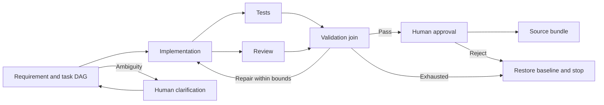

# Agentic URL Shortener

A FastAPI URL shortener with a LangGraph engineering workflow that plans changes, generates code, runs validation, and pauses for human approval. Built with Python, PostgreSQL, LangChain, and OpenAI.

## Project setup

**Prerequisite:** Docker with Compose installed and running. Python 3.12+ is needed only for local development outside Docker.

1. Clone the repository and open a terminal in its root directory.
2. Create your local configuration:

   ```sh
   cp -n .env.example .env
   ```

   This preserves an existing `.env`. For live AI runs, set `OPENAI_API_KEY` in that file. Demo mode works without a provider key. Keep `.env` out of Git.

3. Build and start the services:

   ```sh
   docker compose up --build -d
   docker compose ps
   ```

| Service | API documentation | Default `X-API-Key` |
| --- | --- | --- |
| Shortener | http://localhost:8000/docs | `local-shortener-key` |
| Engineering | http://localhost:8001/docs | `local-engineering-key` |

Compose starts PostgreSQL, both APIs, a worker, and an internal validation runner. Stop them with `docker compose down`; named volumes retain data and checkpoints.

## Try the project

Import the [Postman collection](postman/AgenticShortener.postman_collection.json) and [local environment](postman/Local.postman_environment.json), then select the local environment. If you changed service keys in `.env`, update them in Postman too. The OpenAI key stays on the worker.

1. Run **01 Shortener** in order: create a link, redirect, and inspect click analytics.
2. Under **02 Engineering**, send one **Start** request, then poll **Get current run**.
3. Inspect the plan, events, source diff, summary, and test/review results. Submit clarification or approval when requested. Send human actions individually.

Postman captures IDs, revisions, and candidate hashes automatically. Creation and analytics require the shortener key; `/engineering/*` requires the engineering key. Redirects and health checks are public. The `/docs` pages list all endpoints and schemas.

### Assessment scenarios

| Scenario | Example |
| --- | --- |
| `greenfield` | Build the shortener APIs, analytics, and reliability features from a service skeleton |
| `brownfield` | Add persisted expiration timestamps and reject expired redirects without counting clicks |
| `ambiguous` | Make links safer; clarify the missing policy before implementation |

**Demo mode** uses fixed recipes with real validation and checkpoints. For the ambiguous demo, answer: “Yes, block malware.test and its subdomains with HTTP 422.” Other policies require live mode. **Live mode** uses OpenAI; set Postman's `agent_mode` to `live` before starting a run. After changing provider settings, recreate the worker with `docker compose up -d --force-recreate worker`.

## Architecture

The engineering API queues jobs in PostgreSQL. A LangGraph worker preserves plans, task dependencies, decisions, and checkpoints. LangChain connects the worker to OpenAI; a separate runner executes candidate tests without provider/database credentials.



Implementation follows task dependencies; tests and review run in parallel. Approval binds the current revision and source hash. Replanning invalidates downstream approvals while retaining earlier evidence. Failures allow two repairs and a 12-call model budget per revision before safe stop. Restricted file paths, isolated execution, a hash-linked journal, and success/retry/rollback/MTTR/latency metrics support change control.

## Testing

Run the full suite, including PostgreSQL integration checks:

```sh
docker compose --profile test run --build --rm tests
```

Tests cover the shortener, all three scenarios, persistent resume, parallel validation, approvals, replanning, bounded repair/rollback, budgets, and runner isolation. Candidate validation uses trusted contracts in `acceptance/` plus generated regression tests.

For local development:

```sh
python3.12 -m venv .venv
.venv/bin/pip install -r requirements.lock
.venv/bin/pip install --no-deps -e .
.venv/bin/pytest
```

Local tests skip two PostgreSQL checks unless `TEST_POSTGRES_URL` is configured. Docker runs them automatically.

## Structure and limitations

`shortener/` contains the application, `engineering/` the workflow, `runner/` isolated validation, `acceptance/` trusted contracts, `tests/` project checks, and `postman/` API requests.

This prototype uses development API keys and initial schema bootstrap. Approval creates a source bundle; deployment and existing-database migrations require separate review. Replanning reruns from the baseline. The journal is not externally signed, and isolation/static checks do not prove security. Live output may fail validation and stop; deterministic demos do not establish model quality. Humans own final review and release. Credentials, runtime data, generated files, and the company PDF are excluded through `.gitignore`.
